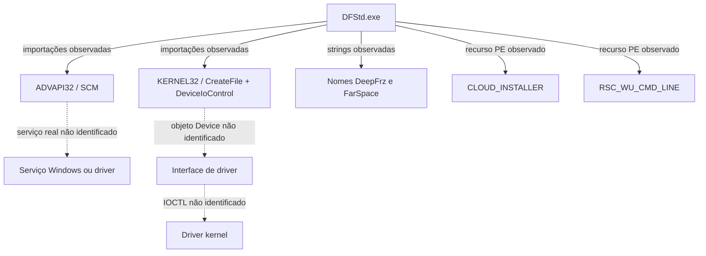

# Interfaces entre instalador, serviços e kernel — REA

**Status:** reconstrução estrutural, não semântica. Fonte: análise estática offline do PE principal Deep Freeze Standard 9.00.020.5760. Não houve instalação, execução ou desassembly dos drivers.

## Observações e próximos testes

| ID | Evidência na tabela de importações ou strings do DFStd.exe | Interpretação limitada | Próximo teste |
|---|---|---|---|
| IF-01 | OpenSCManagerW, CreateServiceW, StartServiceW, ControlService | Há capacidade de interagir com Service Control Manager (SCM) | Mapear call sites e nomes reais dos serviços |
| IF-02 | CreateFileW, DeviceIoControl | Há capacidade de abrir handles e emitir controle de dispositivo | Identificar callers, handles, argumentos e erros |
| IF-03 | DeepFrz.sys, DeepFrzx64.sys, FarSpace.sys, FarSpaceX64.sys (strings) | Referências textuais a nomes de drivers | Localizar binários efetivos, hashes e assinaturas em VM |
| IF-04 | RegLoadKeyW, RegSaveKeyW, RegRestoreKeyW | Há capacidade de manipular hives | Identificar call sites e transições de estado |
| IF-05 | ExitWindowsEx, InitiateSystemShutdownExW | Há capacidade de solicitar reinicialização | Observar efeito em ambiente isolado |
| IF-06 | WINHTTP.DLL / WinHttp* | APIs de rede importadas | Observar chamadas somente em laboratório autorizado |

**Importação não equivale a chamada em runtime.** Referência textual não equivale a instalação do driver.

## Diagrama de hipótese documentada

Setas **contínuas** representam metadados observados; **pontilhadas** são relações hipotéticas ainda não validadas. O diagrama não representa um fluxo de execução comprovado.

## Contrato semântico a preencher por função

1. Identificação: hash, módulo, RVA, contexto x86/x64 e Windows 7 SP1.
2. Entradas: argumentos reais observados e tipo/tamanho de buffers.
3. Saídas: retorno, LastError/NTSTATUS e efeitos persistentes.
4. Controle: caminhos de sucesso, falha, reinicialização e mudanças Frozen/Thawed.
5. Evidências: offset, instrução ou registro controlado em VM, confiança e lacunas.

A etapa 3 adicionou **valores constantes candidatos** extraídos do padrão de pilha nas chamadas a DeviceIoControl. Ver [loop REA](analyses/LOOP_DEVICEIO_2026-10-28.md). Isso **não** prova o valor do argumento em execução, o dispositivo de destino nem o significado dos comandos.

Ainda **desconhecidos**: nomes dos objetos de dispositivo, valores IOCTL confirmados, IRPs, layouts de comunicação, função DriverEntry, drivers carregados e semântica de proteção. Não inferir desses elementos apenas com imports do instalador.

## Requisitos Windows 7

Testar Windows 7 SP1 x86 e x64 separadamente, assinaturas de drivers e inicialização com snapshots. Python CI em Linux não certifica compatibilidade de componentes Windows.
