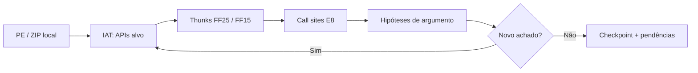

# Metodologia de engenharia de loop REA

**Objetivo:** repetir ciclos de descoberta estrutural e registrar progresso reproduzível, distinguindo fatos observados, hipóteses e incógnitas.



## Etapas e critérios de parada

1. Parser PE com verificação de limites, RVA e arquitetura.
2. Identificação de imports e endereços IAT; filtro de APIs de serviços e dispositivos.
3. Identificação *candidata* dos thunks FF25/FF15 em seções executáveis x86.
4. Busca de `E8 rel32` para esses thunks; agrupamento por API e RVA.
5. Reconhecimento de padrões limitados de argumento imediato antes de `DeviceIoControl`; valores não são contratos confirmados.
6. Checkpoint determinístico JSON/Markdown; quinto ciclo sem novas categorias de candidatos encerra a varredura de padrões implementados.

**Ponto fixo é do analisador de padrões, não da engenharia reversa completa.** Nenhuma chamada é executada ou emulada. Repetir com ferramentas de desassembly, driver ou evidências novas é uma fase futura.

## Limites de segurança e de confiança

- Somente leitura e metadados: nenhum recurso PE é exportado para o repositório.
- Sem ferramentas de desativação de proteção, modificação de driver ou contorno de licença.
- Leitura limitada de ZIP/PE; nomes de arquivo suspeitos ignorados.
- Scanner de bytes não é decodificador integral de instruções; possíveis falsos positivos e falsos negativos.
- Referências a drivers em strings não significam drivers efetivos; código compactado UPX pode ocultar imports.
- Windows 7 SP1 x86/x64 exige validação funcional independente.

## Testar e executar

```bash
python -m unittest discover -s tests -v
python -m tools.rea_loop --archive userfreezer.zip --json loop.json --markdown loop.md
```

O CI só processa fixtures sintéticas. Adicionar versões de ferramentas e hashes às evidências antes de elevar o nível de confiança.

## Análise paralela com checkpoints (REA-015/O)

Os 12 módulos estáticos permitidos podem executar em subprocessos isolados via `python -m tools.rea_parallel_batch`, com resultados locais fora do Git, SHA-256 e checkpoint por tarefa. A integração revisada atualiza o manifesto central, sem concorrência de PRs no mesmo documento. CI e testes sintéticos não são equivalência de execução. [Plano detalhado](acceleration/ENGINEERING_LOOP_PARALLEL_2026-10-29.md).
