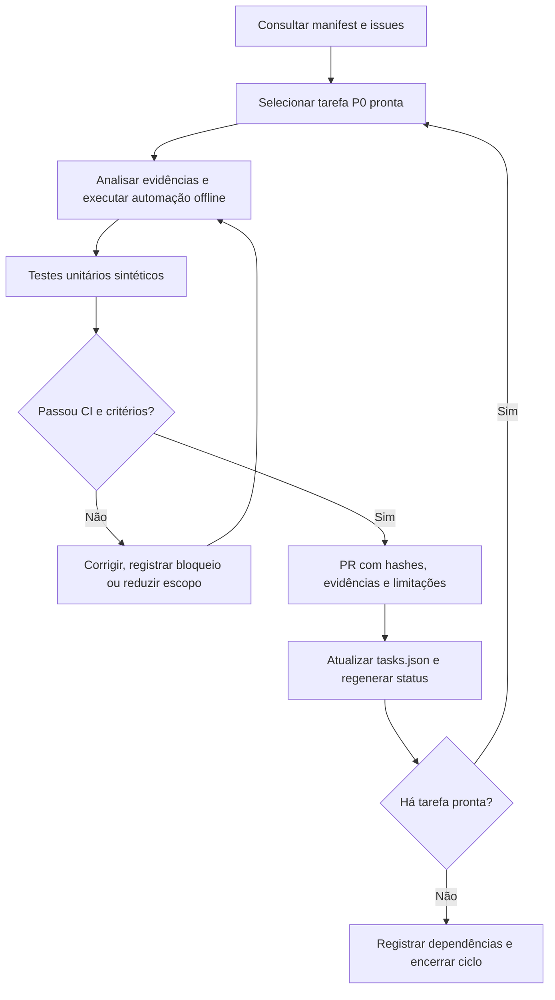

# Plano de ação REA — objetivo, ciclos e critérios de conclusão

**Revisão:** 2026-10-28  
**Repositório:** [c1c3ru/REAdeeprefreezeCraft](https://github.com/c1c3ru/REAdeeprefreezeCraft)  
**Fonte operacional do backlog:** [tasks.json](progress/tasks.json)  
**Quadro gerado:** [STATUS_ATUAL.md](STATUS_ATUAL.md)

## 1. Objetivo claro

**Alcançar 100% de cobertura verificável dos componentes identificáveis do Deep Freeze Standard 9.00.020.5760: inventário recursivo, classificação de regiões executáveis, funções/CFG, parâmetros, interfaces, semântica e equivalência, incluindo Windows 7 SP1 x86 e x64.**

Não há compromisso de recuperar integralmente código-fonte proprietário, afirmar equivalência a priori nem produzir ferramentas de desativação de proteção/licenciamento. O objetivo é engenharia reversa documentada, reprodutível e devidamente testada.

**Definição de sucesso:** para cada comportamento que vier a ser declarado como compreendido, preservar (a) instruções e dados que fundamentam a hipótese, (b) entradas e saídas identificadas, (c) caminhos de sucesso/erro, (d) testes reproduzíveis e resultados, (e) incertezas remanescentes. A compatibilidade de drivers com Windows 7 só poderá ser declarada com evidências de laboratório independentes para cada arquitetura. Falta de evidência resulta em **não verificado**.

## Metas de cobertura integral

O compromisso é com **100% de evidências verificáveis**, não com um número de marketing. Antes de declarar 100% para uma dimensão, seus artefatos e denominadores devem estar fechados. Áreas sem acesso, drivers não recuperados e comportamentos não reproduzidos são **desconhecidos**, nunca tratados como concluídos.

O painel primário dessa meta é [cobertura integral](coverage/STATUS.md) e sua [fonte de verdade](coverage/scope.json), com validador `python -m tools.rea_coverage --check`. A linha de base de duas funções é uma amostra estrutural, não uma certificação funcional. Novas questões são [REA-015](https://github.com/c1c3ru/REAdeeprefreezeCraft/issues/17), [REA-016](https://github.com/c1c3ru/REAdeeprefreezeCraft/issues/18) e [REA-017](https://github.com/c1c3ru/REAdeeprefreezeCraft/issues/19).

## 2. Estado inicial e linhas de base

Em 28/10/2026, os ciclos 1–6 já estão versionados. A etapa 6 documenta uma cadeia `tabela de oito DWORDs → rotina chamadora → auxiliar → DeviceIoControl`, com importações `GetSystemDirectoryA`, `CreateFileA`, `DeviceIoControl` e `CloseHandle`. Os arquivos do produto não foram executados nesta pesquisa.

A última linha de base antes do novo medidor é de **66 testes aprovados** em Python 3.8 e 3.12 no ciclo REA-007/PR #15. Esse total é uma **linha de base**, não uma meta estática; novas mudanças devem acrescentar testes. Os testes exercitam ferramentas e fixtures sintéticas, e não certificam drivers Windows.

A automação de governança implementada neste plano é uma entrega adicional. O contador de tarefas no quadro é um contador administrativo, **não um percentual de completude da engenharia reversa**.

## 3. Portões técnicos e entregas

| Portão | Entrega objetiva | Aceite e evidência |
|---|---|---|
| G0 — inventário | Hashes, módulos PE e recursos rastreáveis | Preservar inventário, versão e métodos; **concluído no escopo estático** |
| G1 — estrutura | Chamadas, imports, CFG delimitado e cadeia entre funções | Scripts, RVA, tabelas de importação e limites explícitos; **concluído no escopo estudado** |
| G2 — controle | Todas as condições de saída e desvios críticos das duas funções | Grafos testados, desvios indiretos identificados; **REA-007** |
| G3 — dados | Proveniência de handles, buffers e resultados | Contratos por argumento com testes sintéticos; **REA-008** |
| G4 — componentes | Drivers reais, arquitetura, assinatura e cadeia de proveniência | Arquivos identificados, SHA-256 e assinatura verificada; **REA-009** |
| G5 — laboratório | Windows 7 SP1 x86 e x64, com VMs isoladas | Evidência de instalação/boot/remoção e cenários seguros; **REA-010/011** |
| G7 — escopo completo | Fechar todos os artefatos e denominadores; classificar regiões não-código, código e desconhecidas | **REA-014/015/016/017**, com painel `docs/coverage/STATUS.md` |
| G6 — contratos | Comportamentos observáveis e equivalência limitada, quando comprovada | Testes por contrato, cobertura do escopo e incertezas; **REA-012/013** |

A sequência de dependência é G0/G1 → (G2, G3, G4 em paralelo) → G5 + contratos → G6. Nenhuma fase bloqueada será marcada concluída por inferência.

## 4. Engenharia de loop — rotina operacional



**Uma iteração:** uma issue com resultado auditável e PR. Todo PR deve conter o código alterado, testes de regressão, artefatos de evidência permitidos, um resumo das hipóteses e os critérios de aceite. O CI revisa automaticamente o estado documental a cada push/PR; isso **não significa que a análise técnica prossiga sozinha sem novos commits, artefatos ou recursos de laboratório**.

### Comandos

```bash
# Rodar toda a suíte (sem ZIP comercial no CI)
python -m unittest discover -s tests -v

# Validar o manifesto, evidências e sincronismo do quadro
python -m tools.rea_progress --check

# Quando uma tarefa muda: atualizar o JSON e regenerar
python -m tools.rea_progress --write

# Visão resumida para scripts externos
python -m tools.rea_progress --json
```

**Regra de conclusão:** status `done` somente depois de satisfazer os critérios de aceite, versionar arquivos comprovantes e obter CI verde. `tools/rea_progress.py` valida existência de evidências, IDs, dependências, ciclos e sincronismo do documento; **não verifica a qualidade semântica** dos resultados. Essa revisão continua obrigatória.

## 5. Próximas ações ordenadas

1. **REA-007 — [issue #9](https://github.com/c1c3ru/REAdeeprefreezeCraft/issues/9):** enumerar saídas e condições dos laços das duas funções candidatas. Confirmar desvios/retornos e sinalizar caminhos não resolvidos; testes sintéticos.
2. **REA-008 — [issue #10](https://github.com/c1c3ru/REAdeeprefreezeCraft/issues/10):** construir rastreamento de `hDevice`, entrada/saída de buffers, tamanhos e resultados entre APIs e funções.
3. **REA-009 — [issue #11](https://github.com/c1c3ru/REAdeeprefreezeCraft/issues/11):** localizar drivers concretos (não apenas strings), inventariar suas versões e verificar assinaturas.
4. **REA-010/011 — [issue #12](https://github.com/c1c3ru/REAdeeprefreezeCraft/issues/12):** preparar VMs isoladas Windows 7 SP1 x86/x64 com snapshots e evidências, após obter o material necessário.
5. **REA-012/013 — [issue #13](https://github.com/c1c3ru/REAdeeprefreezeCraft/issues/13):** sintetizar contratos semânticos e emitir decisão documentada sobre o que foi efetivamente validado.

**REA-007 concluída no escopo das duas janelas de função, com análise estática e testes.** As próximas tarefas prontas são **REA-008** e **REA-009**, que podem ser desenvolvidas em paralelo sem pressupor semântica ainda não verificada.

## 6. Riscos e desbloqueios

| Risco ou bloqueio | Consequência | Ação |
|---|---|---|
| Código UPX e drivers ainda não recuperados | Importações e semântica incompletas | Preservar hashes, ampliar inventário offline e registrar o que não foi encontrado |
| Falsos positivos da análise x86 | CFG/contratos incorretos | Confirmar instruções por CFG e testes, não apenas padrões de bytes |
| Falta de VMs Windows 7 e assinaturas confiáveis | Impossível certificar compatibilidade | Exigir laboratório isolado, snapshots, patches SHA-2 e verificação por arquitetura |
| Dependências externas não resolvidas | Etapas posteriores aguardam | Manter `blocked` ou `todo` com dependências, nunca atribuir sucesso fictício |
| Artefatos comerciais confidenciais | Risco de distribuição indevida | Não versionar executáveis/drivers proprietários; apenas hashes e evidências permitidas |

## 7. Registro da atualização

- **28/10/2026:** auditado o histórico dos ciclos 1–6 e a linha de base de 44 testes.
- **28/10/2026:** issues #9–#13 criadas com critérios de aceite.
- **28/10/2026:** manifesto de tarefas e validação de progresso adicionados por PR; a conclusão desta entrega será confirmada pelo CI.
- **28/10/2026:** REA-007 documentada: 9 desvios condicionais, 2 arestas retroativas, 2 instruções de retorno e mecanismo de enumeração limitada; fluxos executáveis ainda não comprovados.
- **28/10/2026:** meta ampliada para cobertura integral mensurável, com baseline conservador, medidor CI e fila de novas frentes REA-015/016/017.
- **28/10/2026:** REA-015-A: enumeradas 23 entradas ZIP (15 arquivos) e 190 folhas de recursos nos 3 diretórios PE visíveis; mapeadas duas regiões UPX e um container SIB sem semântica compreendida; a tarefa permanece aberta.
- **Próximo checkpoint:** classificar SIB, investigar UPX sem executar, reconciliar arquivos e dependências de driver; REA-008/009 permanecem tarefas prontas em paralelo. Windows 7 SP1 x86/x64 segue não testado.
